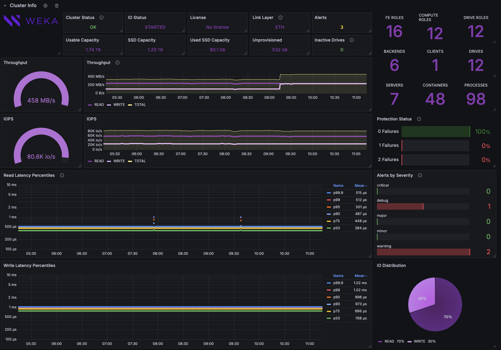
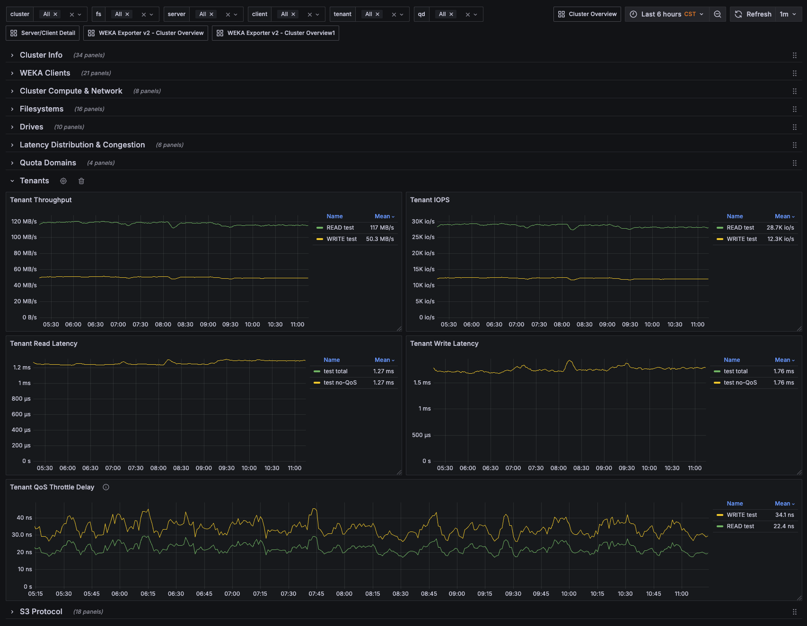

# WEKA LWH Exporter v2 — Grafana Dashboard

Grafana dashboard for the **WEKA Local WEKA Home (LWH) Prometheus Exporter v2**, scraped from:

```
/api/v3/clusters/<cluster_id>/stats/prometheus/v2            # cluster
/api/v3/clusters/<cluster_id>/stats/prometheus/v2/clients
/api/v3/clusters/<cluster_id>/stats/prometheus/v2/drives
/api/v3/clusters/<cluster_id>/stats/prometheus/v2/quota_domains
```

See [Prometheus scrape example](#prometheus-scrape-example) for setup.

| | |
|---|---|
| Dashboard title | `WEKA LWH Exporter v2` |
| UID | `weka-exporter-v2-2` |
| Grafana | 11.6.x (schemaVersion 41) |
| Datasource | Prometheus |
| Tags | `wekahome`, `weka`, `exporter-v2` |
| Default range / refresh | last 6h / 1m |

## Screenshots

**Cluster Info**: status, capacity, throughput/IOPS, protection, alerts, latency percentiles, IO distribution



**Row overview and Tenants**: template variables, collapsed rows, tenant throughput/IOPS/latency/QoS delay



## Repository layout

```
.
├── README.md
├── dashboards/
│   └── weka-lwh-exporter-v2.json   # Grafana dashboard JSON model
└── images/                         # README screenshots
    ├── cluster-info.png
    └── rows-tenants.png
```

## Template variables

| Variable | Source | Used by |
|---|---|---|
| `$cluster` | `label_values(weka_cluster_status, cluster_name)` | All panels |
| `$fs` | `label_values(weka_filesystem_capacity_bytes, fs_name)` | Filesystems |
| `$server` | `label_values(weka_cpu_utilization_percent, server_name)` | Compute & Network, Drives |
| `$client` | `label_values(weka_posix_client_metadata_ops_per_second, server_name)` | WEKA Clients |
| `$tenant` | `label_values(weka_tenant_read_ops_per_second, tenant_name)` | Tenants |
| `$qd` | `label_values(weka_qd_write_ops_per_second, qd_name)` | Quota Domains |

All variables are multi-select with an `All` (`.*`) option.

## Dashboard sections

| Row | Default | Highlights |
|---|---|---|
| **Cluster Info** | expanded | Cluster / IO / license status, link layer, alerts, capacity, inactive drives, role & server counts, throughput, IOPS, protection level, read/write latency percentiles, metadata ops & latency, QoS delay, process health |
| **WEKA Clients** | expanded | Per-client POSIX throughput, IOPS, latency (incl. QoS-excluded), metadata ops, latency percentiles, IO-size heatmaps, client CPU |
| **Cluster Compute & Network** | collapsed | CPU by role/server, busiest processes, pending IOs, NIC RX/TX bytes and errors |
| **Filesystems** | collapsed | FS / snapshot / OBS bucket counts, SSD vs. OBS capacity breakdown, per-FS throughput, IOPS, latency, data reduction ratio |
| **Drives** | collapsed | Inactive drives table, temperature, SMART media errors & critical warnings, per-drive throughput/IOPS/latency |
| **Latency Distribution & Congestion** | collapsed | Read/write duration heatmaps, choking level, TX queue full (cluster + top servers) |
| **Quota Domains** | collapsed | Per-QD throughput, IOPS, latency |
| **Tenants** | collapsed | Per-tenant throughput, IOPS, latency (with/without QoS), QoS delay |
| **S3 Protocol** | collapsed | Buckets, SLB connections/requests/resets, API ops & failures, TTFB/TTLB, per-FS S3 traffic, lifecycle ops |

## Installation

### Grafana UI

1. **Dashboards → New → Import**.
2. Upload `dashboards/weka-lwh-exporter-v2.json`.
3. Pick your Prometheus datasource and import.

> The JSON references the datasource UID `ffyvyko3uo6bkd`. If your Prometheus datasource has a different UID, either select it at import time or replace the UID in the file:
>
> ```bash
> sed -i 's/ffyvyko3uo6bkd/<your-datasource-uid>/g' dashboards/weka-lwh-exporter-v2.json
> ```

## Prometheus scrape example

> Reference: [Export cluster metrics from LWH to Prometheus](https://docs.weka.io/monitor-the-weka-cluster/the-wekaio-support-cloud/export-cluster-metrics-to-prometheus) (WEKA docs)

Exporter V2 is the supported version starting with LWH 5.0 (V1 is deprecated). To enable it, open the cluster in LWH, go to the **Prometheus Exporter** tab, select **Generate Token**, and copy the endpoint URLs under **Prometheus Exporter URL v2**. The token is shown only once. Each cluster has one active token, and generating a new one invalidates the old one.

V2 exposes four endpoints. This dashboard uses metrics from all of them, so add one scrape job per endpoint:

| Endpoint | Content |
|---|---|
| `<base-url>` | Cluster health, capacity, S3 |
| `<base-url>/clients` | Per-client and per-filesystem I/O |
| `<base-url>/drives` | Per-drive health, I/O, network |
| `<base-url>/quota_domains` | Per-quota-domain I/O |

The full metric list is available in LWH via **Download YAML** under **Metric Reference**.

```yaml
# prometheus.yaml
scrape_configs:

  - job_name: weka_cluster
    metrics_path: <base-url>
    scheme: https
    scrape_interval: 1m
    authorization:
      credentials: <your-token>
    static_configs:
      - targets: ['<lwh-host>']

  - job_name: weka_clients
    metrics_path: <base-url>/clients
    scheme: https
    scrape_interval: 1m
    authorization:
      credentials: <your-token>
    static_configs:
      - targets: ['<lwh-host>']

  - job_name: weka_drives
    metrics_path: <base-url>/drives
    scheme: https
    scrape_interval: 1m
    authorization:
      credentials: <your-token>
    static_configs:
      - targets: ['<lwh-host>']

  - job_name: weka_quota_domains
    metrics_path: <base-url>/quota_domains
    scheme: https
    scrape_interval: 1m
    authorization:
      credentials: <your-token>
    static_configs:
      - targets: ['<lwh-host>']
```

| Placeholder | Value |
|---|---|
| `<lwh-host>` | LWH hostname from the cluster settings URL |
| `<base-url>` | Path portion of the endpoint URL from the token dialog (e.g. `/api/v3/clusters/<cluster_id>/stats/prometheus/v2`) |
| `<your-token>` | Authentication token from the token dialog |

Panels use a `1m` minimum interval, so a 1-minute scrape interval is recommended. To limit which metrics are exported, see [Configure selective Prometheus metric collection](https://docs.weka.io/monitor-the-weka-cluster/the-wekaio-support-cloud/configure-selective-prometheus-metric-collection).

## Exporter v2 metrics reference (LWH 5.0.2)

> The information below is for **LWH 5.0.2**. Metric names, labels and endpoints may change in other LWH versions; download the current list from LWH (**Prometheus Exporter** tab → **Metric Reference** → **Download YAML**). The raw 5.0.2 file is in [`docs/exporter-v2-metrics-lwh-5.0.2.yaml`](docs/exporter-v2-metrics-lwh-5.0.2.yaml).

102 metrics across 4 endpoints. All values are pre-computed rates, averages or windowed values: **do not apply `rate()`**. Histograms (`untyped`, with an `le` label) are scraped as `<name>_bucket`, and `histogram_quantile()` is applied to them directly. **Dashboard** marks metrics used by this dashboard.

### Categories

| Category | Endpoint |
|---|---|
| `cluster` | `/` |
| `container` | `/` |
| `drive` | `/drives` |
| `filesystem` | `/clients` |
| `obs` | `/` |
| `posix_client` | `/clients` |
| `process` | `/` |
| `qd` | `/quota_domains` |
| `s3` | `/` |
| `server_network` | `/` |
| `tenant` | `/` |

### Collections

Collections are predefined metric groups that can be used for [selective metric collection](https://docs.weka.io/monitor-the-weka-cluster/the-wekaio-support-cloud/configure-selective-prometheus-metric-collection).

| Collection | Endpoint | Metrics |
|---|---|---|
| `cluster_health` | `/` | `weka_cluster_status`, `weka_cluster_alerts_count`, `weka_cluster_drives_count`, `weka_cluster_container_count`, `weka_cluster_protection_level_percent`, `weka_cluster_io_status` |
| `cluster_inventory` | `/` | `weka_cluster_capacity_bytes`, `weka_cluster_license_status`, `weka_cluster_link_type`, `weka_obs_buckets_count` |
| `cluster_performance` | `/` | `weka_cluster_read_bytes_per_second`, `weka_cluster_write_bytes_per_second`, `weka_cluster_read_ops_per_second`, `weka_cluster_write_ops_per_second`, `weka_cluster_metadata_ops_per_second`, `weka_cluster_metadata_latency_seconds_avg`, `weka_cluster_read_latency_seconds_avg`, `weka_cluster_write_latency_seconds_avg`, `weka_cluster_read_duration_seconds`, `weka_cluster_write_duration_seconds`, `weka_cluster_api_requests_per_second`, `weka_cluster_choking_level_per_second`, `weka_cluster_choking_level_top_servers`, `weka_cpu_utilization_percent` |

### Endpoint `/` (61 metrics)

<details>
<summary>Show metrics</summary>

| Metric | Type | Labels | Category | Description | Dashboard |
|---|---|---|---|---|---|
| `weka_cluster_alerts_count` | gauge | `severity` | cluster | Number of currently active (non-muted) alerts by severity. Emits all 5 severities including zeros. | ✅ |
| `weka_cluster_api_requests_per_second` | gauge | `http_code_group` | cluster | Weka management API request rate by HTTP response code group, cluster-wide. Value is already a rate — use directly without rate(). | ✅ |
| `weka_cluster_capacity_bytes` | gauge | `capacity_type` | cluster | Cluster storage capacity in bytes by capacity type. | ✅ |
| `weka_cluster_choking_level_per_second` | gauge | — | cluster | Rate of IO throttling events on CLIENT processes, cluster-wide. Value is already a rate. | ✅ |
| `weka_cluster_choking_level_top_servers` | gauge | `server_name`, `container_id`, `container_name` | cluster | IO throttling event rate for the top 5 CLIENT servers by choking level. This query scans the full choking.choking_level_all stat (~5.6M series at scale). | ✅ |
| `weka_cluster_container_count` | gauge | `mode`, `status` | cluster | Count of Weka containers by mode. role is omitted — a container can hold processes of multiple roles making role-based counts ambiguous. Use weka_container_process_count for role breakdown. | ✅ |
| `weka_cluster_drives_count` | gauge | `status` | cluster | Count of cluster drives by provisioning status (active or total). | ✅ |
| `weka_cluster_io_status` | gauge | `status` | cluster | Weka cluster I/O status. Value is always 1; the current status is carried in the status label. | ✅ |
| `weka_cluster_license_status` | gauge | `status` | cluster | Weka cluster license status. Value is always 1; the current status is carried in the status label. | ✅ |
| `weka_cluster_link_type` | gauge | `link_type` | cluster | Weka cluster data-plane link layer type. Value is always 1; ETH=Ethernet, IB=InfiniBand. | ✅ |
| `weka_cluster_metadata_latency_seconds_avg` | gauge | `op_type` | cluster | Average metadata latency in seconds per op type at the POSIX Driver layer, cluster-wide. Value is already an average. | ✅ |
| `weka_cluster_metadata_ops_per_second` | gauge | `op_type` | cluster | Metadata operation rate per op type at the POSIX Driver layer, cluster-wide. Value is already a rate. | ✅ |
| `weka_cluster_protection_level_percent` | gauge | `num_failures` | cluster | Percentage of cluster data at each protection level. num_failures=0 means data is fully protected; higher values indicate data at risk. Always emits all observed protection levels including zero-percent entries. | ✅ |
| `weka_cluster_read_bytes_per_second` | gauge | — | cluster | Read throughput in bytes/sec at the POSIX Driver layer, cluster-wide. Counts all protocols. Value is already a rate. | ✅ |
| `weka_cluster_read_duration_seconds` | untyped | `le` | cluster | Read operation duration histogram, cluster-wide, all protocols. le label is in seconds (converted from microseconds). | ✅ |
| `weka_cluster_read_latency_seconds_avg` | gauge | — | cluster | Average read latency in seconds at the POSIX Driver layer, cluster-wide. | ✅ |
| `weka_cluster_read_ops_per_second` | gauge | — | cluster | Read IOPS at the POSIX Driver layer, cluster-wide. Value is already a rate. | ✅ |
| `weka_cluster_read_qos_delay_seconds_avg` | gauge | — | cluster | Average QoS throttle delay in seconds for read operations, cluster-wide across all processes. Value is already an average — use directly without rate(). Subtract from weka_cluster_read_latency_seconds_avg for latency without QoS contribution. | ✅ |
| `weka_cluster_status` | gauge | `status` | cluster | 1 if the cluster is in an operational state (OK/REBUILDING/REDISTRIBUTING), 0 otherwise. A single series is emitted; the status label carries the current cluster status. | ✅ |
| `weka_cluster_txq_full_per_second` | gauge | — | cluster | Cluster-wide TX queue full events per second across all ports. | ✅ |
| `weka_cluster_txq_full_top_servers` | gauge | `server_name`, `container_id`, `container_name`, `process_id` | cluster | TX queue full rate for the top 5 servers/processes (snapshot ranking per scrape cycle). Labels identify the offending server/container/process. | ✅ |
| `weka_cluster_write_bytes_per_second` | gauge | — | cluster | Write throughput in bytes/sec at the POSIX Driver layer, cluster-wide. Counts all protocols. Value is already a rate. | ✅ |
| `weka_cluster_write_duration_seconds` | untyped | `le` | cluster | Write operation duration histogram, cluster-wide, all protocols. le label is in seconds (converted from microseconds). | ✅ |
| `weka_cluster_write_latency_seconds_avg` | gauge | — | cluster | Average write latency in seconds at the POSIX Driver layer, cluster-wide. | ✅ |
| `weka_cluster_write_ops_per_second` | gauge | — | cluster | Write IOPS at the POSIX Driver layer, cluster-wide. Value is already a rate. | ✅ |
| `weka_cluster_write_qos_delay_seconds_avg` | gauge | — | cluster | Average QoS throttle delay in seconds for write operations, cluster-wide across all processes. Value is already an average — use directly without rate(). Subtract from weka_cluster_write_latency_seconds_avg for latency without QoS contribution. | ✅ |
| `weka_container_pending_ios_per_second` | gauge | `server_name`, `container_name`, `container_id`, `mode`, `role` | container | Rate of pending I/O operations per second per container. Value is already a rate — use directly in dashboards without rate(). | ✅ |
| `weka_container_process_count` | gauge | `server_name`, `container_id`, `container_name`, `mode`, `role`, `status` | container | Number of Weka processes per server container, by role, mode, and status. | ✅ |
| `weka_obs_buckets_count` | gauge | `status` | obs | Number of object store buckets. Only emitted if cluster has tiered filesystems. | ✅ |
| `weka_cpu_utilization_percent` | gauge | `server_name`, `container_id`, `container_name`, `mode`, `role`, `process_id` | process | Per-process CPU utilization as a percentage (0..100). Derived from the Weka reactor's idle vs. cycles_per_second counters; value is already averaged over the rate window — use directly without rate(). | ✅ |
| `weka_s3_api_failures` | gauge | `api` | s3 | S3 API failure count per API type, cluster-wide (server-side 5xx + handler errors). | ✅ |
| `weka_s3_api_ops` | gauge | `api` | s3 | S3 API operations per API type, cluster-wide (per-interval gauge — do not apply rate()). | ✅ |
| `weka_s3_api_ttfb_seconds` | gauge | `api` | s3 | S3 server-side time-to-first-byte per API type, cluster-wide, in seconds. | ✅ |
| `weka_s3_api_ttlb_seconds` | gauge | `api` | s3 | S3 server-side time-to-last-byte per API type, cluster-wide, in seconds. | ✅ |
| `weka_s3_bucket_ops_per_second` | gauge | `op_type` | s3 | S3 bucket management operation rate per operation type, cluster-wide. op_type={create\|list\|delete}. Value is already a rate. | ✅ |
| `weka_s3_buckets_count` | gauge | — | s3 | Total number of S3 protocol buckets on the cluster. Distinct from weka_obs_buckets_count. | ✅ |
| `weka_s3_fs_read_bytes` | gauge | `fs_name`, `fs_id` | s3 | S3 read bytes per filesystem, cluster-wide (per-interval gauge). | ✅ |
| `weka_s3_fs_requests` | gauge | `fs_name`, `fs_id`, `api` | s3 | S3 API requests per filesystem and API type, cluster-wide (per-interval gauge). | ✅ |
| `weka_s3_fs_status` | gauge | `fs_name`, `fs_id`, `code` | s3 | S3 HTTP response status count per filesystem and code class, cluster-wide (per-interval gauge). code={2xx\|3xx\|4xx\|5xx}. | ✅ |
| `weka_s3_fs_write_bytes` | gauge | `fs_name`, `fs_id` | s3 | S3 write bytes per filesystem, cluster-wide (per-interval gauge). | ✅ |
| `weka_s3_lifecycle_bucket_ops_per_second` | gauge | `op_type`, `bucketname` | s3 | S3 lifecycle task file operation rate per operation type and S3 bucket, cluster-wide. Value is already a rate — use directly in dashboards without rate(). | ✅ |
| `weka_s3_lifecycle_ops_per_second` | gauge | `op_type`, `shard` | s3 | S3 lifecycle task file operation rate per action type, cluster-wide. Shard granularity. op_type={processed\|deleted}. | ✅ |
| `weka_s3_slb_active_connections` | gauge | — | s3 | Active S3 load-balancer downstream connections, cluster-wide. | ✅ |
| `weka_s3_slb_requests_per_second` | gauge | `http_code_group` | s3 | S3 load-balancer request rate per HTTP response code group, cluster-wide. Value is already a rate. | ✅ |
| `weka_s3_slb_rx_resets_per_second` | gauge | — | s3 | Rate of S3 load-balancer TCP connection resets received, cluster-wide. Value is already a rate. | ✅ |
| `weka_s3_slb_tx_resets_per_second` | gauge | — | s3 | Rate of S3 load-balancer TCP connection resets sent, cluster-wide. Value is already a rate. | ✅ |
| `weka_s3_ttlb_seconds` | untyped | `le` | s3 | S3 time-to-last-byte duration histogram, cluster-wide. le labels in seconds (converted from milliseconds). Values are windowed; do not apply rate(). For per-API average TTLB use weka_s3_api_ttlb_seconds. | ✅ |
| `weka_server_network_receive_bytes_per_second` | gauge | `server_name`, `container_id`, `container_name`, `mode` | server_network | Per-server network receive throughput in bytes/sec, summed across all ports. | ✅ |
| `weka_server_network_receive_errors_per_second` | gauge | `server_name`, `container_id`, `container_name`, `mode`, `error_type` | server_network | Per-server network receive errors by error type (errors, missed, no_mbufs). | ✅ |
| `weka_server_network_transmit_bytes_per_second` | gauge | `server_name`, `container_id`, `container_name`, `mode` | server_network | Per-server network transmit throughput in bytes/sec, summed across all ports. | ✅ |
| `weka_server_network_transmit_errors_per_second` | gauge | `server_name`, `container_id`, `container_name`, `mode` | server_network | Per-server network transmit errors per second. | ✅ |
| `weka_tenant_read_bytes_per_second` | gauge | `tenant`, `tenant_name` | tenant | Read throughput in bytes/sec at the POSIX Driver layer, per tenant. Counts all protocols. Value is already a rate. | ✅ |
| `weka_tenant_read_latency_no_qos_seconds_avg` | gauge | `tenant`, `tenant_name` | tenant | Average read latency excluding QoS throttle delay, in seconds, per tenant. Pure storage latency, with throttle time removed. | ✅ |
| `weka_tenant_read_latency_seconds_avg` | gauge | `tenant`, `tenant_name` | tenant | Average read latency in seconds at the POSIX Driver layer, per tenant. | ✅ |
| `weka_tenant_read_ops_per_second` | gauge | `tenant`, `tenant_name` | tenant | Read IOPS at the POSIX Driver layer, per tenant. Value is already a rate. | ✅ |
| `weka_tenant_read_qos_delay_seconds_avg` | gauge | `tenant`, `tenant_name` | tenant | Average QoS throttle delay in seconds for read operations, per tenant. Value is already an average — use directly without rate(). A non-zero value means the tenant's reads are being throttled by QoS limits. | ✅ |
| `weka_tenant_write_bytes_per_second` | gauge | `tenant`, `tenant_name` | tenant | Write throughput in bytes/sec at the POSIX Driver layer, per tenant. Counts all protocols. Value is already a rate. | ✅ |
| `weka_tenant_write_latency_no_qos_seconds_avg` | gauge | `tenant`, `tenant_name` | tenant | Average write latency excluding QoS throttle delay, in seconds, per tenant. Pure storage latency, with throttle time removed. | ✅ |
| `weka_tenant_write_latency_seconds_avg` | gauge | `tenant`, `tenant_name` | tenant | Average write latency in seconds at the POSIX Driver layer, per tenant. | ✅ |
| `weka_tenant_write_ops_per_second` | gauge | `tenant`, `tenant_name` | tenant | Write IOPS at the POSIX Driver layer, per tenant. Value is already a rate. | ✅ |
| `weka_tenant_write_qos_delay_seconds_avg` | gauge | `tenant`, `tenant_name` | tenant | Average QoS throttle delay in seconds for write operations, per tenant. Value is already an average — use directly without rate(). A non-zero value means the tenant's writes are being throttled by QoS limits. | ✅ |

</details>

### Endpoint `/clients` (25 metrics)

<details>
<summary>Show metrics</summary>

| Metric | Type | Labels | Category | Description | Dashboard |
|---|---|---|---|---|---|
| `weka_filesystem_capacity_bytes` | gauge | `fs_name`, `fs_id`, `capacity_type` | filesystem | Per-filesystem capacity in bytes, broken out by capacity type. | ✅ |
| `weka_filesystem_data_reduction_ratio` | gauge | `fs_name`, `fs_id` | filesystem | Per-filesystem data reduction ratio (uncompressed bytes / compressed bytes stored on SSD). 1.0 means no reduction. | ✅ |
| `weka_filesystem_read_bytes_per_second` | gauge | `fs_name`, `fs_id` | filesystem | Per-filesystem read throughput in bytes/sec. Value is already a rate. | ✅ |
| `weka_filesystem_read_latency_seconds_avg` | gauge | `fs_name`, `fs_id` | filesystem | Per-filesystem average read latency in seconds. | ✅ |
| `weka_filesystem_read_ops_per_second` | gauge | `fs_name`, `fs_id` | filesystem | Per-filesystem read IOPS. Value is already a rate. | ✅ |
| `weka_filesystem_snapshot_count` | gauge | `fs_name`, `fs_id` | filesystem | Number of snapshots per filesystem. | ✅ |
| `weka_filesystem_write_bytes_per_second` | gauge | `fs_name`, `fs_id` | filesystem | Per-filesystem write throughput in bytes/sec. Value is already a rate. | ✅ |
| `weka_filesystem_write_latency_seconds_avg` | gauge | `fs_name`, `fs_id` | filesystem | Per-filesystem average write latency in seconds. | ✅ |
| `weka_filesystem_write_ops_per_second` | gauge | `fs_name`, `fs_id` | filesystem | Per-filesystem write IOPS. Value is already a rate. | ✅ |
| `weka_posix_client_metadata_latency_seconds_avg` | gauge | `server_name`, `container_id`, `container_name`, `op_type` | posix_client | Per-POSIX-client average metadata-op latency in seconds, by op_type. | ✅ |
| `weka_posix_client_metadata_ops_per_second` | gauge | `server_name`, `container_id`, `container_name`, `op_type` | posix_client | Metadata operation rate per op_type, per POSIX client. Value is already a rate. | ✅ |
| `weka_posix_client_read_bytes_per_second` | gauge | `server_name`, `container_id`, `container_name` | posix_client | Per-POSIX-client read throughput in bytes/sec. | ✅ |
| `weka_posix_client_read_duration_seconds` | untyped | `server_name`, `container_id`, `container_name`, `le` | posix_client | Read operation duration histogram per POSIX client. le in seconds. Do not apply rate() before histogram_quantile(). | ✅ |
| `weka_posix_client_read_latency_no_qos_seconds_avg` | gauge | `server_name`, `container_id`, `container_name` | posix_client | Per-POSIX-client average read latency excluding QoS-induced delay, in seconds. | ✅ |
| `weka_posix_client_read_latency_seconds_avg` | gauge | `server_name`, `container_id`, `container_name` | posix_client | Per-POSIX-client average read latency in seconds. | ✅ |
| `weka_posix_client_read_ops_per_second` | gauge | `server_name`, `container_id`, `container_name` | posix_client | Per-POSIX-client read IOPS. | ✅ |
| `weka_posix_client_read_qos_delay_seconds_avg` | gauge | `server_name`, `container_id`, `container_name` | posix_client | Per-POSIX-client average QoS throttle delay applied to read ops, in seconds. | ✅ |
| `weka_posix_client_read_size_bytes` | untyped | `server_name`, `container_id`, `container_name`, `le` | posix_client | Read operation size distribution per POSIX client (le in bytes). | ✅ |
| `weka_posix_client_write_bytes_per_second` | gauge | `server_name`, `container_id`, `container_name` | posix_client | Per-POSIX-client write throughput in bytes/sec. | ✅ |
| `weka_posix_client_write_duration_seconds` | untyped | `server_name`, `container_id`, `container_name`, `le` | posix_client | Write operation duration histogram per POSIX client. le in seconds. Do not apply rate() before histogram_quantile(). | ✅ |
| `weka_posix_client_write_latency_no_qos_seconds_avg` | gauge | `server_name`, `container_id`, `container_name` | posix_client | Per-POSIX-client average write latency excluding QoS-induced delay, in seconds. | ✅ |
| `weka_posix_client_write_latency_seconds_avg` | gauge | `server_name`, `container_id`, `container_name` | posix_client | Per-POSIX-client average write latency in seconds. | ✅ |
| `weka_posix_client_write_ops_per_second` | gauge | `server_name`, `container_id`, `container_name` | posix_client | Per-POSIX-client write IOPS. | ✅ |
| `weka_posix_client_write_qos_delay_seconds_avg` | gauge | `server_name`, `container_id`, `container_name` | posix_client | Per-POSIX-client average QoS throttle delay applied to write ops, in seconds. | ✅ |
| `weka_posix_client_write_size_bytes` | untyped | `server_name`, `container_id`, `container_name`, `le` | posix_client | Write operation size distribution per POSIX client (le in bytes). | ✅ |

</details>

### Endpoint `/drives` (10 metrics)

<details>
<summary>Show metrics</summary>

| Metric | Type | Labels | Category | Description | Dashboard |
|---|---|---|---|---|---|
| `weka_drive_inactive` | gauge | `server_name`, `disk_id`, `serial`, `model`, `target_state` | drive | 1 for each inactive drive. Active drives emit no series. Alert on any series existing. | ✅ |
| `weka_drive_read_bytes_per_second` | gauge | `server_name`, `disk` | drive | Read throughput in bytes/sec, per drive per server. Value is already a rate. | ✅ |
| `weka_drive_read_latency_seconds_avg` | gauge | `server_name`, `disk` | drive | Per-drive average read latency in seconds. | ✅ |
| `weka_drive_read_ops_per_second` | gauge | `server_name`, `disk` | drive | Per-drive read IOPS. | ✅ |
| `weka_drive_smart_composite_temp_celsius` | gauge | `server_name`, `disk` | drive | NVMe SMART composite temperature per drive per server, in Celsius. | ✅ |
| `weka_drive_smart_critical_warnings` | gauge | `server_name`, `disk` | drive | NVMe SMART critical warning indicator, per drive per server. Non-zero indicates a SMART warning condition. | ✅ |
| `weka_drive_smart_media_errors` | gauge | `server_name`, `disk` | drive | NVMe SMART media error count, per drive per server. | ✅ |
| `weka_drive_write_bytes_per_second` | gauge | `server_name`, `disk` | drive | Write throughput in bytes/sec, per drive per server. Value is already a rate. | ✅ |
| `weka_drive_write_latency_seconds_avg` | gauge | `server_name`, `disk` | drive | Per-drive average write latency in seconds. | ✅ |
| `weka_drive_write_ops_per_second` | gauge | `server_name`, `disk` | drive | Per-drive write IOPS. | ✅ |

</details>

### Endpoint `/quota_domains` (6 metrics)

<details>
<summary>Show metrics</summary>

| Metric | Type | Labels | Category | Description | Dashboard |
|---|---|---|---|---|---|
| `weka_qd_read_bytes_per_second` | gauge | `inode`, `qd_name`, `fs_name`, `path` | qd | Quota domain read throughput in bytes/sec. Value is already a rate. | ✅ |
| `weka_qd_read_latency_seconds_avg` | gauge | `inode`, `qd_name`, `fs_name`, `path` | qd | Quota domain average read latency in seconds. | ✅ |
| `weka_qd_read_ops_per_second` | gauge | `inode`, `qd_name`, `fs_name`, `path` | qd | Quota domain read IOPS. Value is already a rate. | ✅ |
| `weka_qd_write_bytes_per_second` | gauge | `inode`, `qd_name`, `fs_name`, `path` | qd | Quota domain write throughput in bytes/sec. Value is already a rate. | ✅ |
| `weka_qd_write_latency_seconds_avg` | gauge | `inode`, `qd_name`, `fs_name`, `path` | qd | Quota domain average write latency in seconds. | ✅ |
| `weka_qd_write_ops_per_second` | gauge | `inode`, `qd_name`, `fs_name`, `path` | qd | _(no description in the 5.0.2 YAML)_ | ✅ |

</details>

## Notes

- **Inactive Drives** — active drives emit no series; any value above 0 is a failed or removed drive.
- **Protection Status** — `num_failures=0` below 100% means data at risk.
- **Top 5 Choking / TXQ Full Servers** — top-N membership changes between scrapes, so lines look broken; this is expected.
- **OBS Active Buckets** — only emitted for tiered clusters; shows 0 otherwise.
- **Snapshots** panels subtract 1 from `weka_filesystem_snapshot_count` per filesystem.
- **Top 10 Clients by CPU Utilization** filters on `server=~"$client"` rather than `server_name`; adjust if the label doesn't exist in your environment.

## Contributing

1. Edit the dashboard in Grafana.
2. **Share → Export → Export as JSON** (leave "Export for sharing externally" off to keep the datasource UID).
3. Replace `dashboards/weka-lwh-exporter-v2.json`, bump nothing manually — Grafana manages `version`.
4. Commit with a message describing the panel/query changes.
